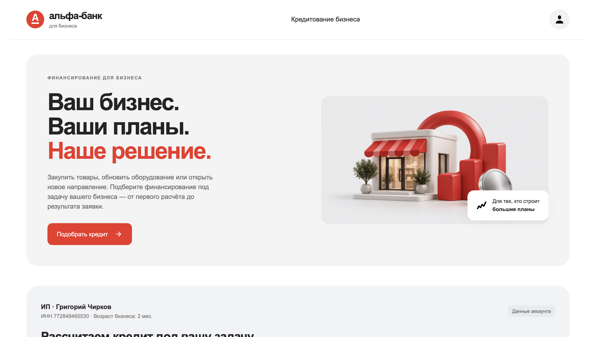
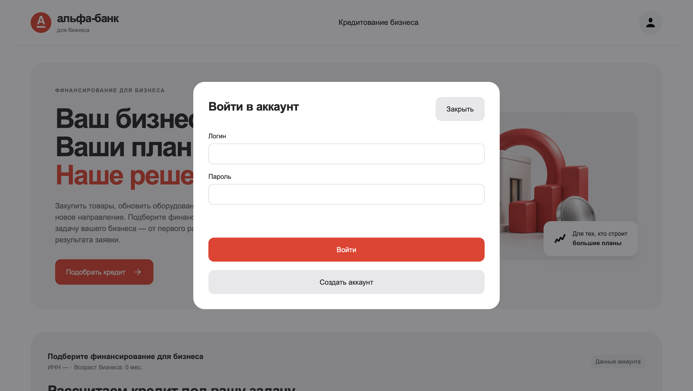
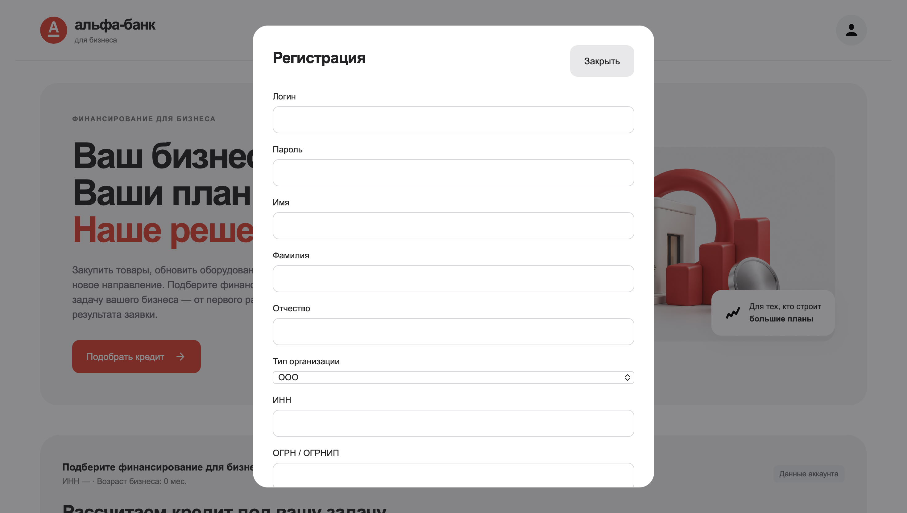
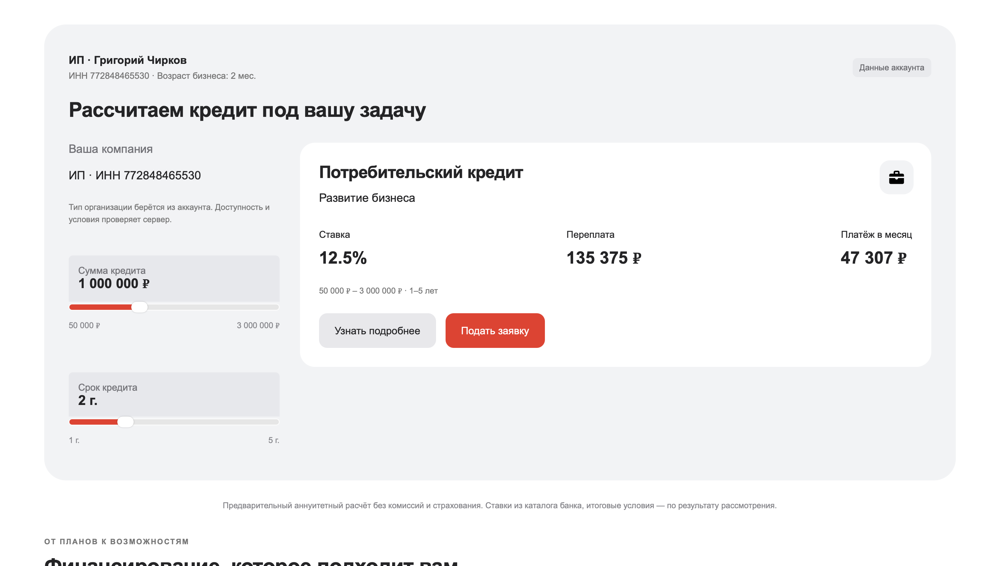
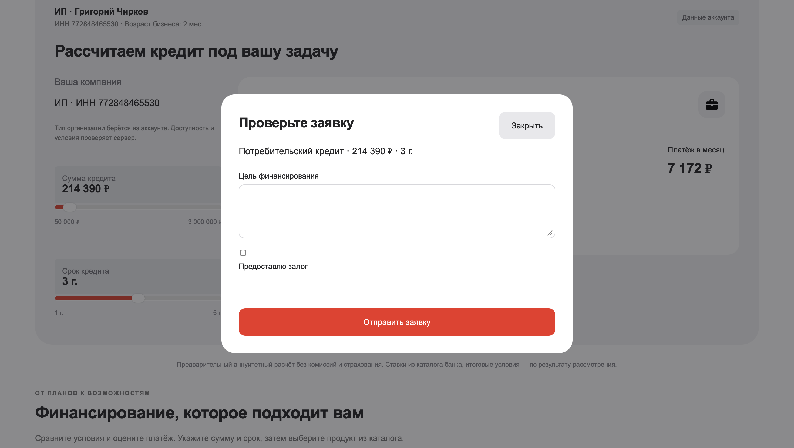
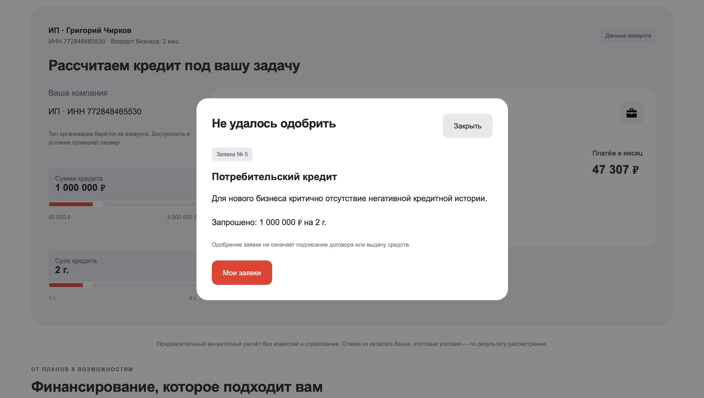
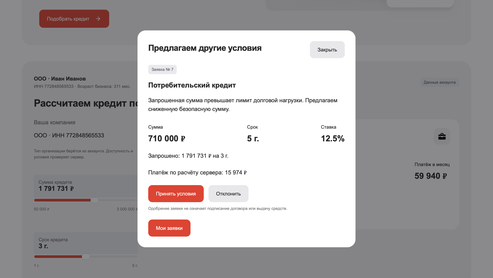
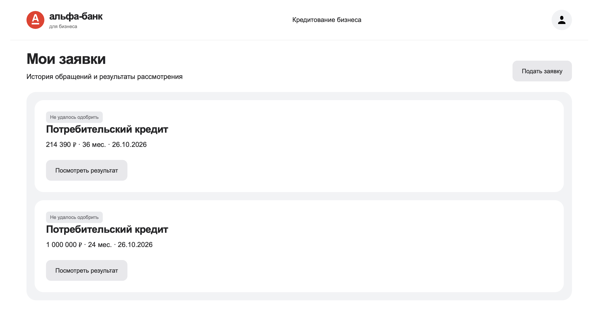

# Умный кредитный кабинет предпринимателя — Mephi_alpha

Прототип для Альфа-Хак: предприниматель регистрирует компанию, выбирает кредитный продукт, рассчитывает параметры, подаёт заявку и получает одобрение, отказ или встречное предложение. Банк оценивает заявку балльной моделью; пограничные случаи доступны для ручного решения через API скоринга.

Это учебный MVP. Финансовые показатели и кредитная история синтетические; подключений к банковским системам, реальной выдачи денег, подписания документов и LLM в приложении нет. Персонализированная новостная лента не реализована. Результат проверки требований: [docs/COMPLIANCE.md](docs/COMPLIANCE.md).

## Скриншоты приложения

### Главная страница



### Вход в аккаунт



### Регистрация



### Кредитный калькулятор



### Подача заявки



### Отказ по заявке



### Встречное предложение



### История заявок



## Архитектура и компоненты

| Компонент | Стек / версии в конфигурации | Назначение |
|---|---|---|
| `frontend` | HTML, CSS, JavaScript ES modules, Nginx 1.28.0 | веб-кабинет, калькулятор, история, proxy |
| `backend/user_server` | Java 21, Kotlin 2.3.21, Spring Boot 4.1.2, JJWT 0.13.0 | регистрация, JWT, профиль |
| `backend/product_server` | Java 21, Kotlin 2.3.21, Spring Boot 4.1.2 | каталог продуктов |
| `backend/application_server` | Java 21, Spring Boot 4.1.2, JJWT 0.13.0 | заявки, статусы, интеграция скоринга |
| `backend/decision_service` | Python 3.11.11, FastAPI 0.115.6, Pydantic 2.10.4, Uvicorn 0.34.0 | скоринг, локальные моки, ручная проверка |
| Три отдельные БД | PostgreSQL 16.6 | пользователи, продукты, заявки |

Схемы взаимодействий, состояний и данных: [docs/ARCHITECTURE.md](docs/ARCHITECTURE.md). Компоненты, происхождение ресурсов и имитации: [THIRD_PARTY_NOTICES](THIRD_PARTY_NOTICES). Правила учёта: [THIRD_PARTY_POLICY.md](THIRD_PARTY_POLICY.md).

## Единый запуск в Docker

Нужны Git, Docker Engine с Docker Compose v2+ и интернет для первой загрузки образов и зависимостей. Java, Maven и Python на хосте для этого способа не нужны. Практический ориентир для сборки: 4 CPU, 8 ГБ RAM и 10 ГБ диска; это оценка, не измеренный минимум.

Из корня репозитория:

```bash
docker compose up --build -d --wait --wait-timeout 300
```

Открыть **http://localhost:8085**. Все сервисы и БД запускаются внутри Compose; каталог заполняется синтетическим продуктом при первой инициализации БД. В контейнерной сети используются имена сервисов. Наружу привязаны frontend и API ручной проверки, оба к `127.0.0.1`.

```bash
docker compose ps
docker compose logs --tail=100
docker compose down
```

`down` сохраняет данные в именованных томах. Не удаляйте тома, если нужны созданные пользователи и заявки. SQL из `demo/products.sql` выполняется автоматически только на новой БД. Для повторного добавления продукта в существующий том:

```bash
docker compose exec -T products-db psql -U product_user -d products < demo/products.sql
```

При занятых портах задайте `FRONTEND_PORT` и `DECISION_PORT` в `.env`. Дождитесь сборки и готовности БД. Если Maven не разрешает указанные версии, это ошибка сборки: не подменяйте версии молча и не считайте запуск проверенным.

## Конфигурация

Compose использует локальные демонстрационные значения. Для изменения скопируйте `.env.example` в `.env`; `.env` исключён из Git. Реальные ключи и клиентские данные не требуются.

| Переменная `.env` | Значение для локальной демонстрации |
|---|---|
| `FRONTEND_PORT` | `8085` |
| `DECISION_PORT` | `8090`, Swagger и API ручной проверки |
| `USERS_DB_PASSWORD` | `user_pass` |
| `PRODUCTS_DB_PASSWORD` | `product_pass` |
| `APPLICATIONS_DB_PASSWORD` | `applications_pass` |
| `JWT_SECRET` | общий демонстрационный ключ из `.env.example` |
| `INTERNAL_SERVICE_TOKEN` | `change-me-internal-token`, токен скоринга и callback |

Compose передаёт `JWT_SECRET` в user_server как `TEST_SECRET_KEY`, а в application_server как `JWT_SECRET`: имена конфигурации в коде различаются. БД настраиваются через `SPRING_DATASOURCE_URL`, `SPRING_DATASOURCE_USERNAME`, `SPRING_DATASOURCE_PASSWORD`. В Compose access-токен действует 15 минут, refresh — 24 часа; без Compose действуют другие значения из `application.properties`.

Внутренние адреса: `PRODUCT_SERVICE_URL=http://product-server:8081`, `DECISION_SERVICE_URL=http://decision-service:8090`, `APPLICATION_SERVICE_URL=http://application-server:8083`; `DECISION_TIMEOUT=5s`. Внешние API и платные ключи не используются. Для публикации требуется отдельная настройка секретов, TLS и доступа сотрудника; текущий Compose предназначен для локальной проверки.

## Пошаговая проверка

1. Запустите Compose и откройте `http://localhost:8085`.
2. В меню профиля выберите регистрацию. Используйте клиента из [demo/README.md](demo/README.md): например ИНН `7700000001`, ООО, ОКВЭД `62.01`, дата регистрации `2019-03-01`. Имя и пароль — тестовые.
3. Выберите «Потребительский кредит», 3 000 000 руб. на 3 года. Подтвердите цель и отправку заявки.
4. Ожидается `ACCEPTED` — одобрено. Проверьте комментарий и сохранение заявки в истории.
5. Выйдите и повторите с клиентом `7700000002`, 3 000 000 руб. на 2 года. Ожидается `COUNTER_OFFER`; принятие предложения переводит заявку в `ACCEPTED`.
6. Клиент `7700000004`, 1 000 000 руб. на 3 года без залога, получает `REJECTED`.
7. Клиент `7700000005` с залогом попадает на ручную проверку. Очередь и `/resolve` доступны в `http://localhost:8090/docs`; в Authorize задайте `INTERNAL_SERVICE_TOKEN`. После решения обновите статус в кабинете.

После перезагрузки страницы нужен повторный вход: токены хранятся в памяти вкладки. Пользователи и заявки сохраняются в PostgreSQL. Очередь ручной проверки хранится в памяти decision_service и теряется при его перезапуске.

## API и материалы

- [Описание API](docs/API.md), [OpenAPI клиентских сервисов](docs/openapi.json), [OpenAPI сервиса решений](docs/decision-openapi.json).
- [Postman-коллекция](docs/requests.postman_collection.json): регистрация, вход, профиль, каталог, заявка, история, встречное предложение, ручное решение.
- [Синтетические данные](demo/README.md), [клиенты JSON](demo/clients.json), [SQL каталога](demo/products.sql).
- [Тестовые сценарии](docs/TEST_SCENARIOS.md) и [чек-лист сдачи](docs/COMPLIANCE.md).

## Разработка и тесты

Вне Docker нужны Java 21, Python 3.11 и три PostgreSQL; инструкции: [backend/BACKEND.md](backend/BACKEND.md), [frontend/README.md](frontend/README.md). Maven 3.10.0 загружается wrapper. Frontend не требует npm-зависимостей; `frontend/dist` содержит исходники и хранится в Git.

```bash
# Node.js 22+; без установки зависимостей
cd frontend
npm test
```

```bash
# Python 3.11, отдельное окружение
cd backend/decision_service
python3.11 -m venv .venv
. .venv/bin/activate
python -m pip install -r requirements-dev.txt
python -m pytest tests
```

```bash
# Проверка доступа к профилю без БД
cd backend/user_server
sh ./mvnw -Dtest=ProfileAccessTests test
```

Полные Spring context-тесты требуют БД. Docker-сборка пропускает тесты; успешная сборка не подтверждает E2E. Результаты текущей проверки записаны в [docs/COMPLIANCE.md](docs/COMPLIANCE.md).

## Версия для сдачи

История разработки хранится в Git. Идентификатор версии получите **после коммита всех сдаваемых изменений** командой `git rev-parse HEAD` и укажите при сдаче. Рабочий каталог с незакоммиченными изменениями нельзя обозначать хешем предыдущего коммита. Для приватного репозитория команда предоставляет доступ жюри `alfa-hack-2026` до дедлайна. Доступ, публикация и финальный commit hash локальной проверкой не подтверждены.
