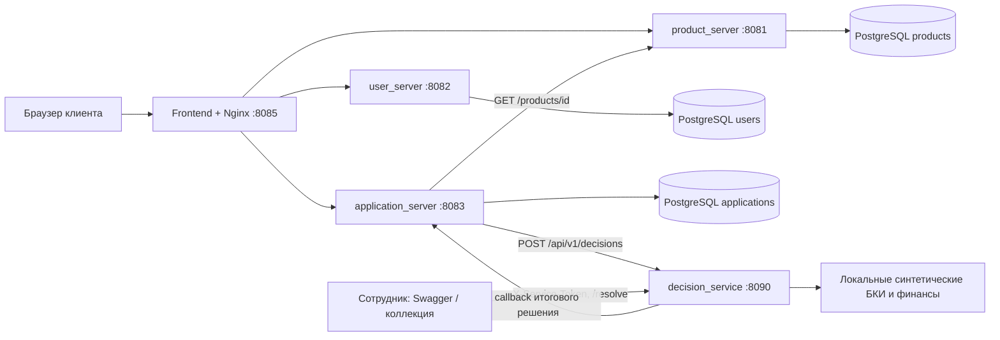
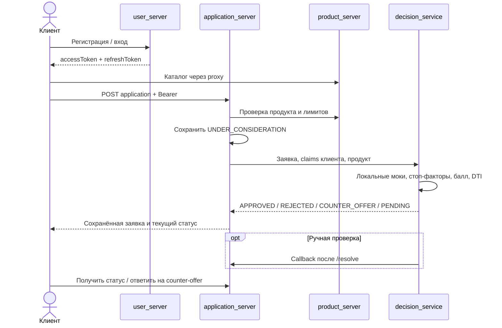
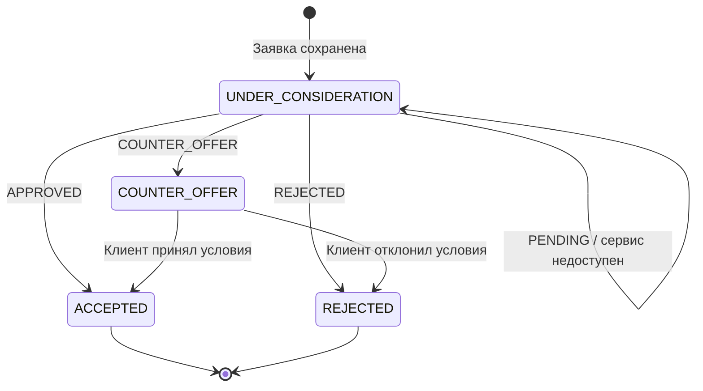
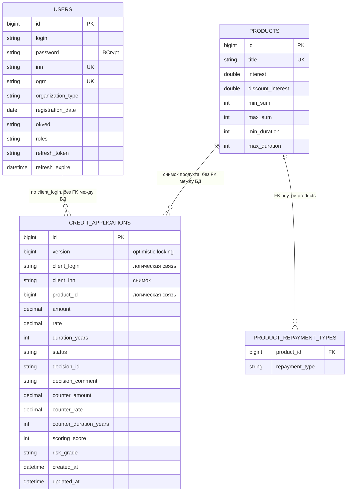

# Архитектура, процесс и модель данных

## Границы MVP

Клиенту нужны подбор суммы/срока, однократный ввод реквизитов, прозрачный статус и возможность ответить на встречное предложение. Банку нужны проверка параметров, оценка риска и обработка пограничных случаев. Это продуктовые предположения по кейсу, не результаты проведённых интервью.

В MVP включены регистрация, каталог, заявка, обогащение синтетическими финансовыми показателями, балльная модель и ручное решение через API. Подписание, выдача денег, документы, новости и отдельный интерфейс сотрудника не реализованы. Скоринг отделён от решения: балл задаёт рейтинг и предельную долговую нагрузку; условия продукта и стоп-факторы могут изменить исход.

## Архитектурная схема

Клиентские запросы идут через один origin, без CORS между браузером и сервисами. JWT выдаётся user_server и проверяется application_server общим ключом. Внутренний callback не проксируется frontend. В Compose БД и Java API не публикуются на хост, Swagger скоринга доступен только на localhost. Сотрудник в MVP использует общий сервисный токен; персонального RBAC для сотрудников нет.

## Сквозной процесс

## Диаграмма состояний заявки

`APPROVED` в сервисе решений соответствует `ACCEPTED` в заявке. `PENDING` не отдельный клиентский статус, он оставляет `UNDER_CONSIDERATION`. Решение сотрудника приходит тем же callback. Повтор callback с тем же decisionId после итогового решения возвращает текущее состояние; ответ на уже обработанное встречное предложение даёт 409. У частичного `counterOffer` поля `null` означают сохранение исходных условий.

Отдельные состояния decision_service: `DECIDED` (автоматическое решение), `PENDING` (очередь), `RESOLVED` (решение сотрудника). Доставка callback фиксируется отдельно: `IN_PROGRESS`, `DELIVERED`, `FAILED`.

## Модель данных

Дополнительно у пользователя сохраняется ФИО; у продукта — цели, условия скидки и описание; у заявки — цель, залог, тип организации, снимок названия/ставки продукта и метрики платежа, DTI, рентабельности. Полные поля: DTO и [OpenAPI](openapi.json). Денежные поля заявки — BigDecimal/NUMERIC; вычисления скоринга используют float.

`StoredDecision` хранится в памяти Python: decisionId, applicationId, fingerprint запроса, response, recommendation, статус, причина ручной проверки, resolvedBy, callbackStatus и даты. Это не четвёртая БД. Повтор запроса скоринга требует `Idempotency-Key = applicationId`; POST клиентской заявки идемпотентности не имеет.

## Ограничения надёжности и безопасности

- Очередь и идемпотентность скоринга теряются при перезапуске; несколько реплик decision_service не имеют общего состояния.
- При недоступности скоринга заявка сохраняется, но планировщика повторной отправки нет. Кнопка обновления статуса повторно скоринг не запускает.
- Callback имеет до пяти попыток при сетевой ошибке/5xx; после исчерпания требуется вмешательство.
- PostgreSQL сохраняется в томах; схемой Java управляет `ddl-auto=update`, версионируемых миграций нет.
- В исходных properties есть демонстрационные секреты; Compose переопределяет их. Logout отзывает refresh, access остаётся действителен до истечения.
- Персональный доступ сотрудника, TLS, аудит действий и промышленная эксплуатация не реализованы. Собственные Java healthcheck проверяют TCP-порт; это не полная проверка бизнес-функций.
