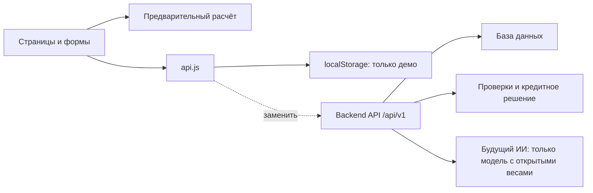
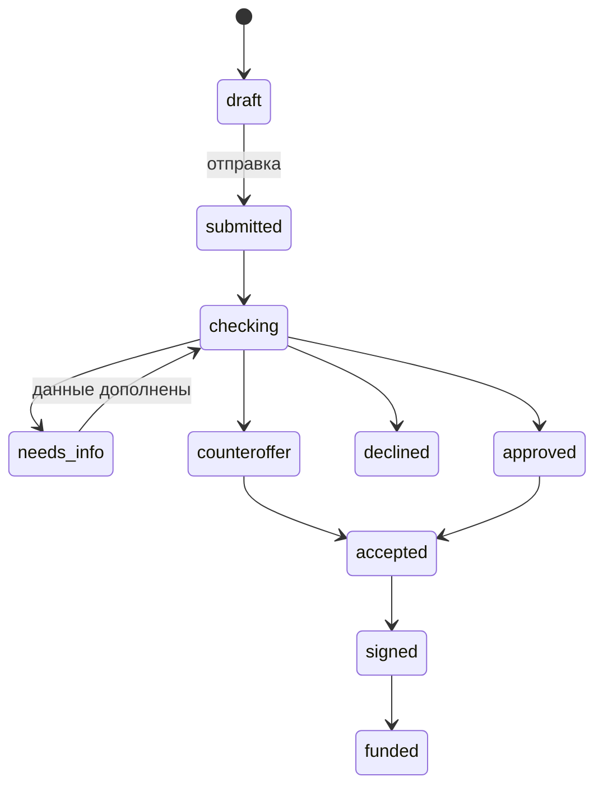

# Передача backend-разработчику

## Архитектура


Точки замены: listApplications(), createApplication(data), assistant(). Все методы асинхронны. Для production добавить getSession/login/logout и серверную проверку доступа; маршруты интерфейса не защищают данные. Сохранить контракт результата адаптера, заменить localStorage на fetch. Добавить состояния загрузки, 401, 403, 422, 429 и 5xx, отмену запросов при навигации. Ошибки API должны иметь code, message, fieldErrors, requestId.

## Модель данных
Application: id UUID, company string до 120 символов, inn string 10/12 цифр, revenue number RUB/month, ageMonths integer, amount number RUB 100000–10000000, months integer 6–60, purpose enum, status enum, createdAt ISO UTC. Серверу добавить ownerId, version, updatedAt и историю переходов. Текущая проверка ИНН проверяет только длину, без контрольного числа, чтобы разрешать синтетические данные.

## Будущие состояния


Сейчас UI создаёт только submitted. Сервер должен проверять допустимость переходов, идентификатор владельца и полномочия роли; frontend не принимает кредитных решений. На клиенте добавить русские подписи всех статусов и дальнейшее действие для needs_info/counteroffer. Опрос статусов либо SSE подключить после определения backend-контракта.

## Интеграционные требования

- Суммы API — рубли; проценты — годовые процентные пункты, не дробь. Для production согласовать integer minor units или decimal и правила округления.
- Окончательный расчёт на сервере, с версиями правил и сроком действия предложения. Клиентскому расчёту не доверять.
- Авторизация через защищённую серверную сессию и HttpOnly Secure cookie; проверка CSRF при cookie-auth, same-origin API предпочтителен.
- Идемпотентность POST заявок, серверная валидация всех полей, optimistic locking при изменениях.
- Данные реальных клиентов не хранить в localStorage. Не передавать секреты в frontend. ИИ не должен самостоятельно одобрять кредит.
- Получение документов, БКИ, ФНС, подпись и выдача не входят в этот frontend. Для хакатона использовать серверные моки, зафиксировать их в THIRD_PARTY_NOTICES.
- API-контракт ниже — предложение интерфейса интеграции, не работающий сервер.

## Пример запроса
```http
POST /api/v1/applications
Content-Type: application/json
Idempotency-Key: demo-001

{"company":"ООО Пример","inn":"0000000000","revenue":900000,"ageMonths":24,"amount":1500000,"months":24,"purpose":"Оборотные средства"}
```

Acceptance: повторный idempotency key не создаёт дубль; пользователь не видит чужие заявки; отрицательные суммы дают 422; неавторизованный запрос даёт 401; отказ/уточнение/альтернативные условия дают корректное действие в UI. Эти проверки требуют backend и пока не исполняются.

## Обновлённая навигация
Калькулятор только #/. CTA калькулятора → #/login → выбор «Тестовый аккаунт» → #/cabinet. «Другой» disabled. Кабинет содержит общие типы кредитов; #/select открывает модальный ИИ-диалог поверх кабинета. Закрытие/Escape → #/cabinet. #/logout удаляет демосессию. В шапке до входа отображается «Войти», после входа кнопка полностью скрывается; выход восстанавливает её. sessionStorage — только UI-мок, backend обязан заменить его настоящей сессией.
